<p align="center">
  
</p>

# 📱 Awesome Mobile Agent 🚀

<p align="center">
  <a href="https://github.com/ishandutta2007/Awesome-Awesome-Awesome"></a><a href="https://discord.gg/jc4xtF58Ve"></a> <a href="https://github.com/ishandutta2007/Awesome-Mobile-Agent/stargazers"></a> <a href="https://github.com/ishandutta2007/Awesome-Mobile-Agent/blob/main/LICENSE"></a> <a href="https://github.com/ishandutta2007/Awesome-Mobile-Agent/pulls"></a> <a href="https://github.com/ishandutta2007"></a>
</p>

---

### 🌐 Curated Directory of Mobile Agents, Unified Endpoint Management (UEM) & Zero-Trust Mobile Security

> A production-grade index tracking industry-leading **Enterprise SaaS Platforms** and sovereign **Open-Source Software (OSS)** for mobile endpoint administration, automated device supervision, field agent enablement, and autonomous multimodal AI phone operators.

Whether you are managing thousands of enterprise iOS and Android devices, orchestrating ruggedized frontline terminals, locking down BYOD fleets with MAM containers, or evaluating next-generation multimodal vision agents that interact with mobile apps, this directory provides verified commercial pricing, free-tier thresholds, market valuations, and GitHub community metrics.

---

## 📑 Table of Contents

- [📊 Sector Overview & Market Dynamics](#-sector-overview--market-dynamics)
- [🏢 Enterprise SaaS Platforms](#-enterprise-saas-platforms)
- [💻 Open-Source GitHub Projects](#-open-source-github-projects)
- [🧩 Architectural Comparison & Deployment Archetypes](#-architectural-comparison--deployment-archetypes)
- [🤝 How to Contribute](#-how-to-contribute)
- [📈  Star History](#--star-history)
- [💖 Support & Sponsorship](#-support--sponsorship)
- [⚖️ Disclaimer](#️-disclaimer)

---

## 📊 Sector Overview & Market Dynamics

The global **Unified Endpoint Management (UEM)** and Mobile Agent market is estimated at **$8.6 Billion to $10.5 Billion in 2026** and projected to exceed **$30 Billion by 2034**, expanding at a compound annual growth rate (CAGR) of **~22% to 24%**. Growth is driven by ubiquitous hybrid workforces, regulatory zero-trust compliance mandates, widespread Bring-Your-Own-Device (BYOD) policies, and the convergence of traditional MDM/MAM with autonomous AI operational agents.

From a market structure perspective, the enterprise UEM ecosystem is **moderately concentrated** at the top tier—dominated by tech giants like Microsoft (Intune) and Omnissa/KKR (VMware Workspace ONE) who command the majority of large enterprise multi-OS estates. However, the market remains **highly fragmented across specialized verticals**:
- 🍏 **Apple Enterprise Specialization**: Platforms like Jamf dominate education and Apple-first enterprises.
- 🚚 **Rugged & Frontline Devices**: SOTI leads specialized warehouse scanners, logistics terminals, and field-worker handhelds.
- 🏢 **SMB & Sovereign Infrastructure**: Mid-market players like ManageEngine, Scalefusion, and self-hosted open-source servers (Headwind MDM, MicroMDM, Cairn-MDM) thrive where organizations resist per-device lock-in.
- 🤖 **Multimodal Mobile AI Agents**: High-velocity frontier research (e.g., Alibaba Mobile-Agent) is unlocking autonomous on-device GUI actions, decoupling operational workflows from fixed API integrations.

---

## 🏢 Enterprise SaaS Platforms

Below is the verified breakdown of leading commercial SaaS platforms for mobile endpoint oversight and field agent operations, **sorted descending by company scale (market cap / corporate valuation)**.

| 🏢 Platform & App | 🏛️ Vendor | 📊 Company Scale (Valuation / Revenue) | 💵 Starting Tier Pricing | 🎁 Free Tier / Trial Limits | ⚙️ Primary Capabilities & Ecosystem Focus |
| :--- | :--- | :--- | :--- | :--- | :--- |
| **[Microsoft Intune](https://learn.microsoft.com/intune/)** | Microsoft | **~$3.12 Trillion** *(FY24 Rev: $245.1B)* | **$8.00** / user / month *(Plan 1 standalone, billed annually)* | **30-day free trial** with up to 25 user licenses and full admin center access | Cross-platform UEM (Windows, iOS/iPadOS, Android, macOS, Linux, ChromeOS), MAM data protection, conditional access, and Copilot AI troubleshooting. |
| **[IBM Security MaaS360](https://www.ibm.com/products/maas360)** | IBM | **~$215 Billion** *(FY24 Rev: $61.9B)* | **$4.00** / device / month *(Essentials plan, billed annually)* | **30-day free trial** with complete policy deployment and multi-device enrollment | AI-assisted mobile threat defense (MTD) powered by Watson Advisor, encrypted container apps (Mail, PIM), DLP enforcement, and multi-OS oversight. |
| **[ServiceNow Mobile Agent](https://apps.apple.com/app/servicenow-agent/id1446951408)** | ServiceNow | **~$195 Billion** *(FY24 Rev: $10.9B)* | **~$100.00** / fulfiller user / month *(ITSM Pro tier; mobile client app free download)* | **Free permanent Personal Developer Instance (PDI)** with full Mobile Agent support (reclaimed after 10 days inactivity); commercial 30-day PoC | Mobile-first field service & IT service desk client enabling offline incident triage, native barcode scanning, signature capture, and cross-departmental flows. |
| **[Citrix Endpoint Management](https://docs.citrix.com/citrix-endpoint-management/)** | Cloud Software Group *(Citrix)* | **~$16.5 Billion** *(PE buyout by Vista/Elliott; Rev: $3.2B)* | **$3.25** / device / month *(Standalone baseline tier, billed annually)* | **30-day Proof of Concept (PoC)** evaluation for scoped test device fleets upon sales request | Enterprise MDM/MAM with NetScaler micro-VPN per-app tunneling, Citrix MAM SDK containerization, and native Citrix DaaS/VDI workspace integration. |
| **[ManageEngine Endpoint Central](https://www.manageengine.com/products/desktop-central/)** | Zoho Corporation | **~$12.0 Billion** *(Private bootstrapped valuation; Rev: $1.4B+)* | **$795.00** / year for 50 endpoints *(~$1.33/device/mo On-Premises; Cloud at ~$1.75/device/mo)* | **Free forever plan** for up to 25 endpoints and 1 technician; plus 30-day unlimited endpoint free trial | Unified endpoint management covering automated multi-OS patch management, mobile kiosk mode, geofencing, remote lock/wipe, and asset tracking. |
| **[Ivanti Neurons for UEM](https://www.ivanti.com/products/ivanti-neurons-uem)** | Ivanti | **~$4.5 Billion** *(Clearlake Capital / TA Associates; Rev: $1.5B)* | **~$7.50** / device / month *(~$90/device/year baseline enterprise subscription)* | **30-day Proof of Concept (PoC)** / guided trial environment via enterprise sales request | Autonomous endpoint self-healing, Apple Declarative Device Management (DDM), Android Enterprise app configurations, Passkey attestation, and MTD. |
| **[VMware Workspace ONE](https://www.omnissa.com/platform/unified-endpoint-management/)** | Omnissa *(formerly VMware EUC)* | **~$4.0 Billion** *(Acquired by KKR in 2024; Rev: $1.5B)* | **$3.00** / device / month *(Mobile Essentials tier, billed annually; Employee Essentials at $1.67/device/mo)* | **30-day evaluation trial** environment upon request with scoped test fleet enrollment | Gartner Magic Quadrant UEM Leader; zero-touch enrollment, automated app lifecycle management, digital employee experience (DEX) analytics, and intent workflows. |
| **[Jamf Pro](https://www.jamf.com/products/jamf-pro/)** | Jamf | **~$2.1 Billion** *(NASDAQ: JAMF; Rev: $620M)* | **$5.75** / device / month *(Jamf for Mobile iOS/iPadOS, billed annually with 25-device minimum)* | **14-day free trial** with full platform capabilities, no credit card required; Jamf Now offers free forever tier up to 3 devices | Gold-standard Apple mobility management (iOS, iPadOS, macOS, tvOS, visionOS) featuring zero-day Apple OS support, Apple Business Manager synergy, and Self Service portal. |
| **[SOTI MobiControl](https://www.soti.net/products/soti-mobicontrol/)** | SOTI Inc. | **~$1.2 Billion** *(Privately held; Rev: $200M+)* | **$3.25** / device / month *(Cloud SaaS tier, billed annually)* | **30-day free trial** for up to 25 devices with zero upfront credit card or purchase order | Specialized enterprise mobility for rugged handhelds, industrial Android barcode scanners, Windows IoT, and field hardware with SOTI Surf secure browsing. |
| **[Scalefusion](https://scalefusion.com/)** | ProMobi Technologies | **~$120 Million** *(Privately held; Rev: $25M+)* | **$2.00** / device / month *(Essential Plan, billed annually)* | **14-day free trial** with full access to all features, no credit card required | Multi-OS kiosk lockdown (single/multi-app), BYOD containerization, remote screen control & casting, location geofencing, and private enterprise APK delivery. |

---

## 💻 Open-Source GitHub Projects

Open-source mobile device management, automation runtimes, and autonomous agent frameworks are vital for homelabs, sovereign infrastructure, and custom robotic/agentic toolchains.

The projects below are **sorted descending by GitHub community Stars_Count**. Each badge dynamically indicates repository popularity and links directly to that repository's stargazers page.

| 📦 Repository & Link | ⭐ Community Stargazers | 🛠️ Technology & License | 🎯 Description & Core Capabilities |
| :--- | :---: | :--- | :--- |
| **[scrcpy](https://github.com/Genymobile/scrcpy)** | [](https://github.com/Genymobile/scrcpy/stargazers) | `C` • `Apache-2.0` | **High-performance display and remote device agent for Android.** Stream low-latency screen video (35~70ms) and inject touch/mouse/keyboard controls over USB or TCP/IP without requiring root privileges. Essential for remote mobile agent testbeds. |
| **[appium](https://github.com/appium/appium)** | [](https://github.com/appium/appium/stargazers) | `TypeScript` • `Apache-2.0` | **Cross-platform mobile automation framework.** Industry standard automation driver utilizing the W3C WebDriver protocol for native, hybrid, and web apps across iOS, iPadOS, Android, and desktop endpoints. Serves as the backbone for automated mobile test agents. |
| **[Mobile-Agent](https://github.com/X-PLUG/MobileAgent)** | [](https://github.com/X-PLUG/MobileAgent/stargazers) | `Python` • `Apache-2.0` | **Autonomous multi-modal AI mobile device agent family.** Developed by Alibaba, this vision-language agent directly perceives visual GUI screens and autonomously executes multi-step tasks across diverse mobile apps via visual perception and tool-calling. |
| **[fleet](https://github.com/fleetdm/fleet)** | [](https://github.com/fleetdm/fleet/stargazers) | `Go` • `MIT` | **Open-source device management and endpoint observability.** Built upon `osquery`, Fleet provides unified fleet visibility, CIS compliance checks, and configuration monitoring across macOS, Windows, Linux, and mobile devices with real-time SQL queries. |
| **[idb](https://github.com/facebook/idb)** | [](https://github.com/facebook/idb/stargazers) | `Python` / `Objective-C` • `MIT` | **iOS Development Bridge by Meta.** Command-line interface and automation daemon for orchestrating iOS physical hardware and simulators; handles app installations, UI interactions, crash symbolication, and remote debugging workflows. |
| **[stf](https://github.com/DeviceFarmer/stf)** | [](https://github.com/DeviceFarmer/stf/stargazers) | `JavaScript` • `Apache-2.0` | **Smartphone Test Farm (STF).** Control, inspect, and debug fleets of Android smartphones, tablets, and smartwatches remotely from any modern web browser with real-time screen replication and ADB port forwarding. |
| **[micromdm](https://github.com/micromdm/micromdm)** | [](https://github.com/micromdm/micromdm/stargazers) | `Go` • `MIT` | **Core Apple Mobile Device Management protocol server.** Modular server implementation of Apple's MDM specification, ideal for DevOps teams and organizations engineering custom, sovereign device enrollment and configuration delivery pipelines. |
| **[nanomdm](https://github.com/micromdm/nanomdm)** | [](https://github.com/micromdm/nanomdm/stargazers) | `Go` • `MIT` | **Minimalist, high-throughput Apple MDM server & Go library.** A lightweight micro-MDM implementation optimized for embedding directly within modern microservices architectures and edge proxy devices. |
| **[Headwind MDM](https://github.com/h-mdm/hmdm-server)** | [](https://github.com/h-mdm/hmdm-server/stargazers) | `Java` • `Apache-2.0` | **Open-source Android device management system and web console.** Provides remote kiosk configuration, corporate app rollout, background device tracking, and fleet-wide settings management for corporate Android devices. |
| **[Cairn-MDM](https://github.com/nickpdawson/Cairn-MDM)** | [](https://github.com/nickpdawson/Cairn-MDM/stargazers) | `Go` • `MIT` | **Single-binary, self-hosted Apple MDM server.** Embeds NanoMDM, SCEP certificate authority, and an Apple HIG-styled admin console into one Go binary with SQLite backend. Zero Apple Business Manager account required for non-ABM setups. |

---

## 🧩 Architectural Comparison & Deployment Archetypes

When selecting between commercial SaaS platforms and sovereign open-source implementations, evaluate according to the following architectural tiers:

```
┌────────────────────────────────────────────────────────────────────────┐
│                        MOBILE AGENT ECOSYSTEM                          │
├──────────────────────────────────┬─────────────────────────────────────┤
│   Commercial UEM Platforms       │      Sovereign Open-Source Stacks   │
├──────────────────────────────────┼─────────────────────────────────────┤
│ • Zero-touch hardware onboarding │ • Zero licensing cost overhead      │
│ • Turnkey carrier & OS APIs      │ • Full privacy & on-premise data    │
│ • Enterprise Identity (SAML/OIDC)│ • Custom protocol extensibility     │
│ • Global SLA & vendor support    │ • Self-hosted SQLite/Postgres DB    │
└──────────────────────────────────┴─────────────────────────────────────┘
```

1. **Enterprise Fleet Compliance (1,000+ Multi-OS Seats)**:
   - *Recommended*: **Microsoft Intune**, **Workspace ONE**, or **IBM MaaS360**.
   - Offers turnkey Apple Business Manager (ABM), Google Zero-Touch, and Samsung Knox Mobile Enrollment (KME).
2. **Dedicated Apple Fleets**:
   - *Commercial*: **Jamf Pro**.
   - *Open Source*: **Cairn-MDM** (homelab/SMB) or **MicroMDM** / **NanoMDM** (cloud-native engineering).
3. **Dedicated Android Fleets & Kiosks**:
   - *Commercial*: **Scalefusion** or **SOTI MobiControl**.
   - *Open Source*: **Headwind MDM** with **scrcpy** for real-time remote desktop troubleshooting.
4. **Autonomous AI & Robotic GUI Agents**:
   - *Open Source*: **X-PLUG/MobileAgent** combined with **Appium** or **idb** for programmatic sensory perception and action dispatch.

---

## 🤝 How to Contribute

We actively welcome community contributions! To suggest new tools, correct pricing data, or expand open-source entries:

1. 🍴 **Fork the Repository** on GitHub.
2. 🌿 **Create a Feature Branch** (`git checkout -b feature/add-new-mobile-agent`).
3. 📝 **Edit `README.md`**:
   - Add new SaaS entries with **verified starting tier prices**, **explicit free tier/trial limits**, and **company valuation/revenue**.
   - Add new open-source repos with standard `style=social&color=white` Stars_Badges linking to `/stargazers`.
   - Maintain descending sort order for both tables.
4. 📬 **Submit a Pull Request** with a concise summary and source links.

---

##  Star History
[](https://star-history.dera.page/#ishandutta2007/Awesome-Mobile-Agent&type=date&legend=top-left)

---

## 💖 Support & Sponsorship

Thank you for exploring and bookmarking **Awesome-Mobile-Agent**! 🌟

Maintaining an accurate, continuously updated registry of enterprise mobility platforms, pricing shifts, and bleeding-edge open-source mobile agents requires significant research and ongoing validation. If this project helps you in your professional work, homelab, or academic research, please consider supporting its longevity:

- ⭐ **Star this repository** to improve visibility across the developer community.
- 🍴 **Fork and share** with colleagues, IT administrators, and security teams.
- ☕ **Sponsor the Maintainer**: Support ongoing development and curation via the [GitHub Sponsor Dashboard](https://github.com/sponsors/ishandutta2007).

Your sponsorship directly funds independent open-source cataloging and software research! 🙌

---

## ⚖️ Disclaimer

- **Independent Community Curation**: This index is independently compiled for educational and architectural evaluation purposes. Product names, logos, and brands are property of their respective owners.
- **Privacy & Compliance**: Mobile management software enables elevated device control (remote wipe, location monitoring, app enforcement). Implementations must comply with regional privacy regulations (GDPR, CCPA, HIPAA) and corporate acceptable-use policies.
- **Pricing Accuracy**: SaaS pricing, promotional tiers, and subscription packaging change frequently. Always confirm quotes directly with official vendor sales channels before procurement.
